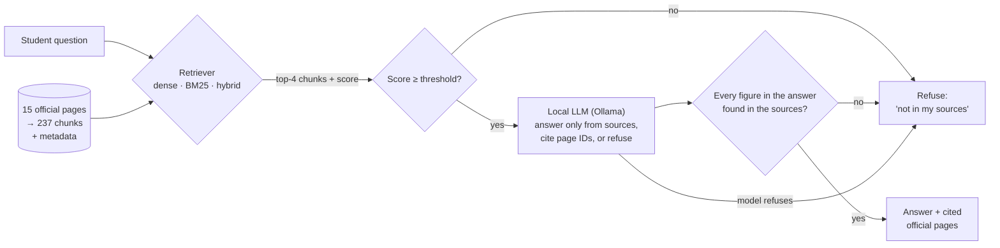

# GovAssist

**A test-driven RAG assistant for international students working in Australia.**

GovAssist answers questions about working while studying in Australia: student-visa work limits, pay, payslips, tax, super, unpaid trials, casual work, unfair treatment and where to get help. It answers only from 15 official Australian Government web pages, shows which page each answer came from, and says so when the pages don't cover a question instead of guessing.

Everything runs locally and for free: the language model runs on your own computer through [Ollama](https://ollama.com), and no API keys are needed.

> Built for *Case Studies in Data Science* (Group 49), following the test-driven RAG approach of [Walert](https://github.com/rmit-ir/walert) (Pathiyan Cherumanal et al., CHIIR '24). We wrote the test set and evaluation framework before building the system, then changed one thing at a time and re-measured.

> **GovAssist gives general information, not legal or migration advice.** For advice about your visa, contact the Department of Home Affairs (13 18 81) or a registered migration agent. For workplace problems, contact the Fair Work Ombudsman (13 13 94).

---

## Contents

1. [Quick start](#1-quick-start)
2. [Requirements](#2-requirements)
3. [Installation, step by step](#3-installation-step-by-step)
4. [Using GovAssist](#4-using-govassist)
5. [Reproducing the results](#5-reproducing-the-results)
6. [Configuration](#6-configuration)
7. [How it works](#7-how-it-works)
8. [Evaluation and results](#8-evaluation-and-results)
9. [Project structure](#9-project-structure)
10. [Troubleshooting](#10-troubleshooting)
11. [Limitations and ethics](#11-limitations-and-ethics)
12. [Data, credits and AI use](#12-data-credits-and-ai-use)

---

## 1. Quick start

If you already have Python 3.10–3.12 and Ollama installed:

```bash
git clone https://github.com/<your-username>/govassist-rag.git
cd govassist-rag

ollama pull llama3.2:3b

python -m venv .venv
# Windows:      .venv\Scripts\activate
# macOS/Linux:  source .venv/bin/activate
pip install -r requirements.txt

pytest                    # should end with "23 passed"
streamlit run app.py      # opens the app in your browser
```

The tuned thresholds are already in the repository (`results/`), so the app works straight after cloning. You don't need to run the evaluation first.

---

## 2. Requirements

| | Minimum | Recommended |
|---|---|---|
| OS | Windows 10/11, macOS 12+, or Linux (64-bit) | |
| RAM | 8 GB | 16 GB |
| Free disk | ~5 GB | |
| GPU | Not needed (runs on CPU) | |
| Python | 3.10, 3.11 or 3.12 | 3.11 (the version we tested) |
| Internet | Only for the first-time downloads | |

**What gets downloaded, and where:**

| Item | Size | Where it goes |
|---|---|---|
| Ollama | ~1 GB | Installed as an app |
| `llama3.2:3b` model | ~2 GB | Ollama's model folder (e.g. `~/.ollama/models`) |
| Python packages (incl. PyTorch) | ~1–2 GB | Your virtual environment |
| Embedding model `BAAI/bge-small-en-v1.5` | ~130 MB | Hugging Face cache (`~/.cache/huggingface`), on first run |
| BERTScore model `roberta-large` | ~1.4 GB | Hugging Face cache, only when you run the evaluation |

---

## 3. Installation, step by step

### Step 1: Install Ollama

| OS | How |
|---|---|
| Windows | Download and run the installer from <https://ollama.com/download/windows>. A llama icon appears near the clock when it's running. |
| macOS | Download the app from <https://ollama.com/download/mac> (or `brew install ollama`), then open it. |
| Linux | `curl -fsSL https://ollama.com/install.sh \| sh` |

Then download the model and check that it works:

```bash
ollama pull llama3.2:3b
ollama run llama3.2:3b "Say hello in five words"
```

You should get a short reply within a few seconds. Ollama must stay running whenever you use GovAssist.

### Step 2: Get the code

```bash
git clone https://github.com/<your-username>/govassist-rag.git
cd govassist-rag
```

Or download the ZIP from GitHub (**Code → Download ZIP**) and extract it.

> **Windows tip:** avoid folders synced by OneDrive (Desktop and Documents often are), or pause OneDrive while you work. Syncing can lock files during a run and cause random `PermissionError`s.

### Step 3: Create a Python environment and install packages

**Option A: venv (comes with Python)**

```bash
python -m venv .venv
# Windows (Command Prompt):  .venv\Scripts\activate
# Windows (PowerShell):      .venv\Scripts\Activate.ps1
# macOS/Linux:               source .venv/bin/activate
pip install -r requirements.txt
```

**Option B: Anaconda / Miniconda**

Open **Anaconda Prompt** on Windows, or any terminal on macOS/Linux:

```bash
conda create -n govassist python=3.11 -y
conda activate govassist
pip install -r requirements.txt
```

> **Linux tip:** by default pip may download the large CUDA build of PyTorch. To get the smaller CPU build, run this **before** `pip install -r requirements.txt`:
> ```bash
> pip install torch --index-url https://download.pytorch.org/whl/cpu
> ```

### Step 4: Check everything works

```bash
pytest
```

You should see **`23 passed`**. The tests run offline in a few seconds, using small stand-ins for the embedding model and the LLM, so they check the code without needing Ollama.

Each time you open a new terminal later, activate the environment again (`.venv\Scripts\activate`, `source .venv/bin/activate` or `conda activate govassist`) and `cd` into the project folder.

---

## 4. Using GovAssist

### The demo app

```bash
streamlit run app.py
```

It opens at <http://localhost:8501>. Stop it with **Ctrl+C** in the terminal.

The first question takes 10–30 seconds while the models load; after that, answers take a few seconds. Each answer shows:
- the answer, with page IDs such as `[D03]`;
- source cards linking to the official pages, with each page's last-updated date;
- how strongly the question matched the knowledge base;
- the retrieved passages, in an expandable section.

The sidebar lets you switch retriever (dense, hybrid or BM25), change how many passages the LLM sees, and turn the two safety checks on or off.

**Questions to try:**

| Try | Expected behaviour |
|---|---|
| Can I work more than 48 hours a fortnight during semester break? | Answers (unlimited hours during scheduled breaks), citing the visa pages |
| My boss pays me cash with no payslip. Is that allowed? | Answers, citing Fair Work pages |
| A cafe wants me to do a free trial week before hiring me. Is that legit? | Answers (unpaid trials beyond showing your skills must be paid) |
| I'm doing a PhD. Can my husband work full time while I study? | Answers (family members of doctoral students have no hour limit) |
| How do I apply for permanent residency? | Refuses: not in the sources |
| What's the Saturday penalty rate for hospitality? | Refuses: sounds in scope, but the pages don't give figures |

### From Python

```python
from src.rag import GovAssist

bot = GovAssist(retriever="dense", threshold="auto")   # uses the tuned threshold in results/
r = bot.answer("Can my employer take money out of my pay if I break something?")

print(r["answer"])          # the answer text, or the refusal message
print(r["citations"])       # e.g. ['D01', 'D13']
print(r["abstained"], r["abstain_reason"])   # refusal flag; reason is threshold / model / unsupported_number
for c in r["retrieved"]:
    print(c["chunk_id"], c["score"], c["source_url"])
```

---

## 5. Reproducing the results

```bash
python run_all.py            # every round: v1, v2, v3 + robustness + figures  (~1.5–2 h on a laptop CPU)
python run_all.py --quick    # final system (v3) only, fast BERTScore model     (~15 min)
```

`run_all.py` runs the tests, then each evaluation in order, and stops at the first error. It overwrites the files in `results/`.

Your numbers may differ from ours by about one question per metric. A local LLM isn't perfectly deterministic across hardware and Ollama versions; even our own two identical runs of the LLM-only baseline differed by one question.

**Running individual steps:**

| Step | Command | Output |
|---|---|---|
| Chunk the pages | `python -m src.ingest --chunk-words 100` | `data/processed/chunks_w100_o40.jsonl` |
| Evaluation 1: retrieval | `python -m src.eval_retrieval` | `results/retrieval/summary.csv`, TREC run files and qrels |
| Tune the abstention threshold (dev set only) | `python -m src.tune_threshold --retriever dense --min-keep 0.95` | `results/threshold_cosine.json` |
| Evaluation 2: end-to-end | `python -m src.eval_generation --tag v3 --number-check` | `results/generation/v3/` (answers, per-question scores, summary, blind grading sheet) |
| Robustness test | `python -m src.eval_generation --tag rob_v3 --number-check --questions evaluation/robustness_questions.csv` | `results/generation/rob_v3/` |
| Manual grading | Fill in `grading_sheet.csv` ([guide](docs/grading_guide.md)), then `python -m src.grading --tag v1` | `manual_summary.csv` with Cohen's kappa |
| Figures | `python -m src.make_figures` | `results/figures/*.png` |
| Walert reproduction | Open `notebooks/walert_pyserini_reproduction.ipynb` in Google Colab | Reproduction tables |

Every script has `--help`. Every round is appended to `results/generation/summary_all.csv`.

---

## 6. Configuration

All settings live in `src/config.py`. You can override them with environment variables instead of editing the code:

| Variable | Default | What it does |
|---|---|---|
| `GOVASSIST_LLM` | `llama3.2:3b` | Ollama model (pull it first with `ollama pull <name>`) |
| `OLLAMA_HOST` | `http://localhost:11434` | Where Ollama is running |
| `GOVASSIST_EMBED_MODEL` | `BAAI/bge-small-en-v1.5` | Sentence-transformers embedding model |
| `GOVASSIST_CHUNK_WORDS` | `100` | Chunk size in words |
| `GOVASSIST_CHUNK_OVERLAP` | `40` | Overlap between chunks in words |
| `GOVASSIST_TOP_K` | `4` | Passages given to the LLM |
| `GOVASSIST_NUMBER_CHECK` | `1` | `1` withholds answers containing figures not found in the sources; `0` turns this off |

How to set one, for example to try a bigger model:

```bash
# macOS/Linux
export GOVASSIST_LLM=qwen2.5:7b
# Windows Command Prompt
set GOVASSIST_LLM=qwen2.5:7b
# Windows PowerShell
$env:GOVASSIST_LLM="qwen2.5:7b"
```

> If you change the **embedding model** or the **chunk size**, re-tune the threshold, because similarity scores change scale:
> `python -m src.tune_threshold --retriever dense --min-keep 0.95`
>
> Changing the LLM doesn't require re-tuning.

---

## 7. How it works



| Component | Choice | Why |
|---|---|---|
| Knowledge base | 15 pages from the Fair Work Ombudsman, Home Affairs, Study Australia and the ATO (`data/raw/`, inventory in `docs/knowledge_base.csv`) | Authoritative; each page's update date is recorded |
| Chunking | ~100 words, 40-word overlap, section-aware, page title prepended (`src/ingest.py`) | Best in a 100/200/400-word sweep |
| Dense retriever | `bge-small-en-v1.5` embeddings, exact cosine search in NumPy | Small, runs on CPU. With 237 chunks a vector database adds nothing |
| Lexical baseline | BM25 (k1=0.9, b=0.4, Porter stemming, Lucene stopwords) | Same settings as Pyserini/Walert |
| Hybrid | Reciprocal rank fusion of BM25 and dense | Evaluated; no gain over dense alone |
| LLM | `llama3.2:3b` via Ollama, temperature 0, fixed seed | Free, local and as deterministic as possible |
| Refusal layer 1 | Retrieval-score threshold, tuned on the dev set only | Cheaply filters clearly off-topic questions |
| Refusal layer 2 | Prompt instruction: answer only from the sources or refuse | Catches questions that sound in scope but aren't answered |
| Refusal layer 3 | Number-grounding check (`src/metrics.py`) | Withholds answers containing invented figures (rates, dollar amounts, hours, visa subclasses) |
| UI | Streamlit (`app.py`) | Browser demo with source cards and a disclaimer |

---

## 8. Evaluation and results

### Test sets (written before the system)

| File | Questions | Purpose |
|---|---|---|
| `evaluation/test_questions.csv` | 35: 15 known, 10 inferred, 5 out-of-KB *far*, 5 out-of-KB *near* | Main test set. *Known* answers are stated on one page. *Inferred* questions are scenarios needing facts combined or applied. *Far* questions are clearly off-topic; *near* questions sound in scope, but the pages don't answer them. |
| `evaluation/robustness_questions.csv` | 20 casually worded questions (15 answerable, 5 out-of-KB) | Added after user testing showed that informally written questions behave differently |
| `evaluation/dev_questions.csv` | 20 | Used **only** to tune the threshold, so test results aren't tuned to the test set |

Each answerable question lists its relevant pages, with the first as the primary source. Graded relevance follows Walert: primary = 2, other relevant = 1.

### Metrics

| Dimension | Metric |
|---|---|
| Retrieval | NDCG@1/3/5, MRR, Hit@3 by question type (`src/metrics.py`, cross-checked against ranx) |
| Refusal (Walert's effectiveness metric) | % of out-of-KB questions left unanswered, split far/near |
| Cost of refusing | % of answerable questions wrongly refused |
| Answer similarity | ROUGE-1 F1 and BERTScore F1 against reference answers |
| Citations | Cited a relevant page? Cited a page it wasn't given? |
| Faithfulness | Answers containing a figure not in the sources (automatic); manual correctness and faithfulness grading by two blind graders with Cohen's kappa |

### Walert reproduction

Scoring Walert's published BM25 run with our code and with ranx gives identical numbers. The Colab notebook rebuilds the index with Pyserini and checks that its ranking matches exactly.

| Walert BM25 | n | NDCG@1 | NDCG@3 | NDCG@5 |
|---|---|---|---|---|
| Known | 84 | 0.512 | 0.491 | 0.473 |
| Inferred | 12 | 0.167 | 0.257 | 0.329 |

From Walert's published generation outputs, their RAG left only 10–20% of out-of-KB questions unanswered.

### Evaluation 1: retrieval

NDCG@3 over all 25 answerable test questions (full table in `results/retrieval/summary.csv`):

| Chunk size | BM25 | Dense | Hybrid |
|---|---|---|---|
| 100 words | 0.721 | **0.908** | 0.891 |
| 200 words | 0.698 | 0.842 | 0.882 |
| 400 words | 0.646 | 0.888 | 0.855 |

Dense retrieval beats BM25 at every chunk size. The gap is biggest on inferred (scenario) questions, which rarely share wording with the pages: 0.59 → 0.90 at 200 words.


### Evaluation 2: end-to-end (35 test questions)

| System | Round | Out-of-KB unanswered (far / near) | Answerable wrongly refused | ROUGE-1 | BERTScore | Cited a relevant page |
|---|---|---|---|---|---|---|
| LLM only (no retrieval) | v1 | **0%** (0 / 0) | 8% | 0.25 | 0.86 | – |
| BM25 RAG | v1 | 40% (40 / 40) | 4% | 0.41 | 0.89 | 83% |
| Dense RAG | v1 | 50% (40 / 60) | 4% | 0.45 | 0.90 | 92% |
| Dense RAG + threshold | v1 | 70% (100 / 40) | 4% | 0.43 | 0.89 | 83% |
| Dense RAG + threshold + prompt | v1 | 90% (100 / 80) | 12% | 0.45 | 0.90 | 86% |
| GovAssist, 100-word chunks | v2 | 90% (100 / 80) | 4% | 0.42 | 0.89 | 96% |
| **GovAssist, final** | **v3** | 70% (60 / 80) | **0%** | 0.43 | 0.89 | 92% |

### Robustness test (20 casually worded questions)

| System | Out-of-KB unanswered | Answerable wrongly refused |
|---|---|---|
| LLM only | 20% | 0% |
| GovAssist v2 | 80% | **60%** (9 of 15) |
| **GovAssist v3** | 80% | **7%** (1 of 15) |


### What the results show

- **Retrieval adds clear value.** Without retrieval, the LLM answered all 10 test questions it had no evidence for, for example inventing fortnightly work-hour limits for the 485 visa. It also made up facts on answerable questions, such as a meaning for "DASP".
- **Each refusal layer contributes.** The threshold alone stopped every far question but only 40% of near misses; adding the prompt instruction raised near misses to 80%.
- **The test-driven loop:**
  - **v1 → v2.** v1 wrongly refused 3 of 25 real questions. The retrieval sweep showed 100-word chunks rank the right page higher, so v2 switched chunk size: wrong refusals fell to 1 of 25 and relevant citations rose from 86% to 96%.
  - **v2 → v3.** Trying the demo with casually worded questions showed that v2 refused 60% of them. The v2 threshold had been tuned on 8 neatly worded dev questions, and casual phrasing scores lower: "I'm doing a PhD, can my husband work full time?" scored about the same as "How do I apply for PR?". v3 retuned the threshold on a larger, more realistic dev set as a coarse off-topic filter, and added the number-grounding check. Wrong refusals on casual questions fell from 60% to 7%.
  - **The cost of v3.** On the neat test set, two clearly off-topic questions (Medicare and driving licences) now reach the LLM and get answered, so far-question refusals dropped from 100% to 60%. We chose v3 for the app because real users write casually.
- **The number-grounding check** withheld 4 answers in v3. Three contained invented figures, such as visa subclasses 189/190 for a permanent-residency question. One was a false positive: "I earn about 15k" wasn't recognised as $15,000.

**Manual grading** (two blind graders, 50 answers: LLM-only vs GovAssist): sheet in `results/generation/v1/grading_sheet.csv`. Scores will be added to `results/generation/v1/manual_summary.csv` once grading is complete.

---

## 9. Project structure

```
govassist-rag/
├── app.py                     Streamlit demo
├── run_all.py                 Reproduce every result (or --quick for the final system only)
├── run_v3.py                  The v3 round on its own
├── requirements.txt
├── data/
│   ├── raw/                   The 15 official pages as text (header: title, agency, URL, dates)
│   └── processed/             Chunks (JSONL); embedding caches are rebuilt automatically
├── docs/
│   ├── knowledge_base.csv     Document inventory: URL, agency, page-updated and retrieval dates
│   └── grading_guide.md       Instructions for the human graders
├── evaluation/                test (35), robustness (20) and dev (20) questions
├── src/
│   ├── config.py              All settings
│   ├── ingest.py              Load and chunk the pages
│   ├── retrieve.py            BM25, dense and hybrid retrievers
│   ├── generate.py            Prompts and the Ollama client
│   ├── rag.py                 The GovAssist pipeline and the LLM-only baseline
│   ├── metrics.py             NDCG, refusal detection, citations, ROUGE, number grounding, kappa
│   ├── eval_retrieval.py      Evaluation 1
│   ├── eval_generation.py     Evaluation 2 and the robustness test
│   ├── tune_threshold.py      Threshold tuning on the dev set
│   ├── grading.py             Combine the human graders' labels
│   └── make_figures.py        Charts
├── notebooks/                 Walert/Pyserini reproduction (Google Colab)
├── tests/                     pytest suite (offline)
└── results/                   Tuned thresholds, all evaluation outputs and figures
```

---

## 10. Troubleshooting

| Problem | Fix |
|---|---|
| `'conda' is not recognized` (Windows) | Use **Anaconda Prompt** from the Start menu, not PowerShell or Command Prompt, or use the venv option instead. |
| `No module named pytest` / `No module named src` | Activate your environment, run `pip install -r requirements.txt`, and run commands from the project's root folder (the one containing `app.py`). |
| `Failed to connect to Ollama` / connection refused | Start Ollama: open the app on Windows/macOS, or run `ollama serve` on Linux. Check with `ollama list`. |
| `model "llama3.2:3b" not found` | `ollama pull llama3.2:3b` |
| The first run seems stuck | It's downloading models (about 130 MB, then 1.4 GB for BERTScore). Later runs are much faster. |
| Warnings about symlinks, `HF_TOKEN`, or a `RobertaModel LOAD REPORT` with UNEXPECTED/MISSING keys | Harmless. Only stop if a run ends with `step failed:` or a Python traceback. |
| `PermissionError` on Windows | The folder is probably synced by OneDrive. Pause syncing or move the project out of OneDrive. |
| A long command fails with "is not recognized as an internal or external command" | The command got split across two lines when pasted. Paste it as one line, or use `python run_all.py`. |
| `KeyboardInterrupt` right after starting a command | Ctrl+C was pressed while it was loading, which can take a while on the first run. Run it again and wait. |
| Port 8501 already in use | `streamlit run app.py --server.port 8502` |
| Linux: pip downloads several GB of CUDA libraries | Install the CPU build of PyTorch first (see Step 3). |
| Running out of memory | Close other apps, or use a smaller model: `ollama pull llama3.2:1b` then set `GOVASSIST_LLM=llama3.2:1b`. |
| Results differ slightly from this README | Expected. The local LLM varies by about one question between runs and machines. |

---

## 11. Limitations and ethics

- **Information, not advice.** In Australia, immigration assistance is regulated: only registered migration agents and lawyers may provide it. GovAssist presents general information from official pages, points users to the right agency, and its prompt forbids telling someone what they personally are eligible for.
- **Refusing over guessing.** A confident wrong answer about visa work limits could lead a student to breach their visa conditions. We report both sides of the trade-off: questions correctly refused and real questions wrongly refused.
- **Sources go out of date, and can disagree.** The knowledge base is a snapshot from **29 September 2026**, and every answer links to the live page. Two of the pages (Study Australia's tax page and the Home Affairs visa page) still mention a "$450 a month" condition for super that was removed in 2022, and GovAssist repeats it when asked about super. Being faithful to the sources is not the same as being correct.
- **Wording sensitivity.** Retrieval scores depend heavily on phrasing. The robustness test exists because a neatly written test set overstated how well the first threshold worked.
- **Scale and variance.** 35 test questions, 20 robustness questions and two graders support comparisons between systems but not fine-grained statistical claims. The v2 chunk size was chosen from a sweep over the test questions, so the v2 gain is slightly optimistic.
- **Privacy.** Questions are processed locally and not stored.
- **Language.** English only. The Fair Work Ombudsman offers help in more than 30 languages; multilingual support is future work.

---

## 12. Data, credits and AI use

**Data.** The text in `data/raw/` was copied from official websites of the Fair Work Ombudsman, the Department of Home Affairs, Study Australia (Austrade) and the Australian Taxation Office on 29 September 2026, for non-commercial educational research. Copyright remains with the Commonwealth of Australia; check each site's copyright notice before reusing the text. Source URLs and dates are in `docs/knowledge_base.csv`.

**References**
- Pathiyan Cherumanal, S. et al. (2024). *Walert: Putting Conversational Information Seeking Knowledge into Action by Building and Evaluating a Large Language Model-Powered Chatbot.* CHIIR '24. <https://doi.org/10.1145/3627508.3638309> · <https://github.com/rmit-ir/walert>
- Lewis, P. et al. (2020). Retrieval-Augmented Generation for Knowledge-Intensive NLP Tasks. NeurIPS 33.
- Cormack, G., Clarke, C. & Büttcher, S. (2009). Reciprocal rank fusion outperforms Condorcet and individual rank learning methods. SIGIR '09.
- Es, S. et al. (2024). RAGAs: Automated Evaluation of Retrieval Augmented Generation. EACL 2024.

**AI use.** Code, the draft test set and this README were drafted with Claude (Anthropic) and reviewed, run and verified by the team. Reference answers were checked against the official pages by team members (see the `verified_by` column in the test set).
